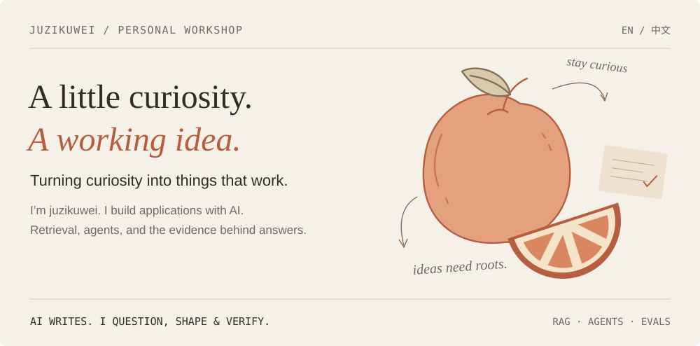
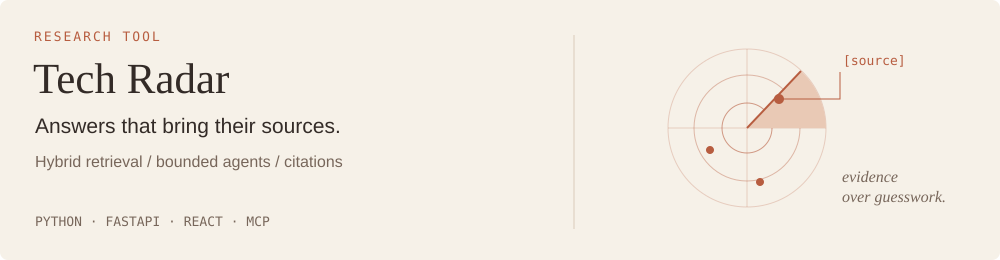
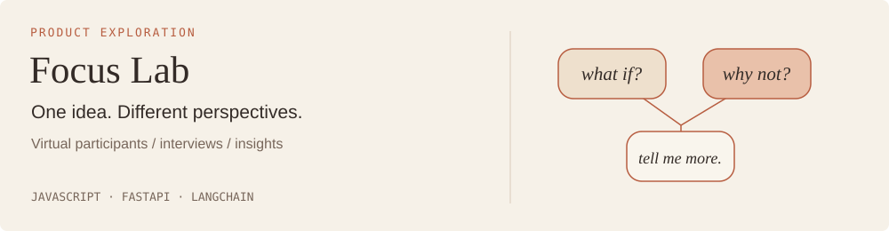
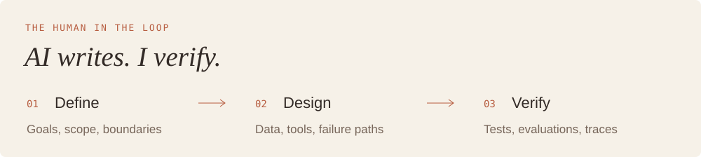

  

  <a href="README.md">简体中文</a> &nbsp; / &nbsp; <strong>English</strong>
  &nbsp; · &nbsp; <a href="https://github.com/juzikuwei?tab=repositories">Repositories</a>
  &nbsp; · &nbsp; <a href="mailto:juzidekuwei@outlook.com">Say hello ↗</a>

 

### Two experiments on the workbench

One asks where an answer comes from. The other explores how an idea looks from different perspectives.

**[AI / Agent Tech Radar ↗](https://github.com/juzikuwei/tech-radar-agent)** &nbsp; A research assistant for AI technical material. Semantic retrieval, BM25, and reranking connect answers to evidence, with citation validation and a read-only MCP service.

 

**[Focus Lab · Virtual focus groups ↗](https://github.com/juzikuwei/focus-group-AI-Agent)** &nbsp; Turn a product concept into participant profiles, interviews, and reports. Supports multiple model interfaces, with drafts and results stored in the browser.

 

### Tools generate. Judgment takes participation.

I write code with **Claude Code / Codex / Cursor** and own product scope, architecture decisions, review, and acceptance. I care about whether the next failure can be understood as much as whether the current output looks good.

> **Notes on my desk** &nbsp; Context compaction · Agent evaluation loops · Claim-level evidence support

Open the notebook: foundations, scaffolding, and reliability

Building an agent system is like building a house: engineering principles form the foundation, frameworks provide scaffolding, and product behavior needs deliberate design.

Define scope before choosing frameworks. Check evidence before drawing conclusions. Treat failure paths as product behavior, and validate large decisions with small experiments.

A few recent footprints

<picture>
  <source media="(prefers-color-scheme: dark)" srcset="https://raw.githubusercontent.com/juzikuwei/juzikuwei/output/github-contribution-grid-snake-dark.svg" />
  
</picture>

 

---

  <em>Stay curious. Build something real.</em>  
  <a href="mailto:juzidekuwei@outlook.com">juzidekuwei@outlook.com</a> &nbsp; · &nbsp; 中文 / English &nbsp; · &nbsp; UTC+8

