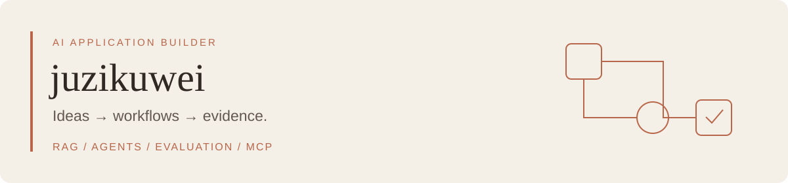
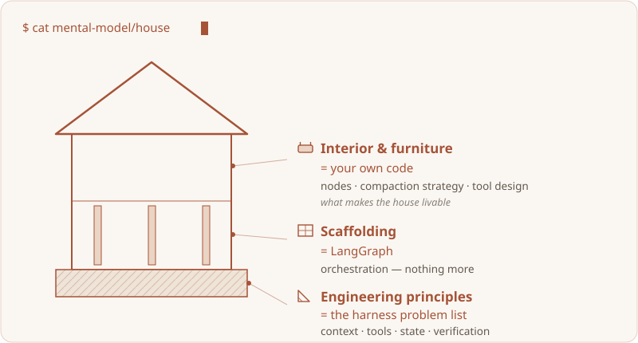
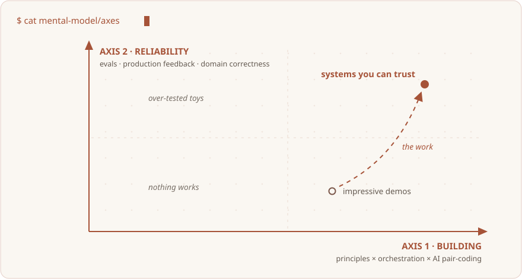

**Turning AI product ideas into testable, observable workflows grounded in evidence.**

[简体中文](README.md) · English · [All projects](https://github.com/juzikuwei?tab=repositories) · [Get in touch](mailto:juzidekuwei@outlook.com)

## Hi, I'm juzikuwei

I build applications around **RAG, agents, and evaluation**, connecting retrieval, tool use, and user interaction. I care about where an answer comes from, how failures can be diagnosed, and how changes can be verified.

I build with Claude Code, Codex, and Cursor. AI writes the code; I own product scope, architecture decisions, review, and acceptance.

## Selected projects

### [AI / Agent Tech Radar](https://github.com/juzikuwei/tech-radar-agent)

**A research assistant for AI technical material, with answers traceable to retrieved evidence.**

- Hybrid semantic and BM25 retrieval, RRF fusion, and cross-encoder reranking.
- Bounded ReAct tool use, deterministic citation validation, and a read-only MCP server.
- A FastAPI + React chat interface connecting retrieval, answers, and evidence.

`Python` · `FastAPI` · `React` · `RAG` · `MCP`

[Explore the code and setup →](https://github.com/juzikuwei/tech-radar-agent#readme)

### [Focus Lab · Virtual focus groups](https://github.com/juzikuwei/focus-group-AI-Agent)

**Turn a product concept into virtual participant profiles, interviews, and structured insight reports.**

- Connect participant generation, moderator outlines, interviews, and reports, with round-by-round control.
- Support multiple model interfaces and optional web research.
- Keep drafts and reports in browser storage to resume and explore later.

`JavaScript` · `Python` · `FastAPI` · `LangChain`

[Explore the code and setup →](https://github.com/juzikuwei/focus-group-AI-Agent#readme)

## How I build

| Stage | What I focus on |
| --- | --- |
| Define the problem | User goals, scope, and acceptance criteria |
| Design the workflow | Explicit data flow, evidence, tool permissions, and failure paths |
| Collaborate with AI | Concrete constraints, review of critical changes, and deliberate trade-offs |
| Verify the result | Tests, evaluations, and traces that guide the next iteration |

**Exploring:** conversation-context compaction, agent evaluation loops, and claim-level evidence support.

More on foundations, scaffolding, and reliability

Building an agent system is like building a house: engineering principles form the foundation, frameworks provide scaffolding, and product behavior needs deliberate design.

Define scope before choosing frameworks. Check evidence before drawing conclusions. Treat failure paths as product behavior, and validate large design decisions with small experiments.

Contribution activity

<picture>
  <source media="(prefers-color-scheme: dark)" srcset="https://raw.githubusercontent.com/juzikuwei/juzikuwei/output/github-contribution-grid-snake-dark.svg" />
  
</picture>

---

Let's talk about AI applications, retrieval, and agent engineering. **[juzidekuwei@outlook.com](mailto:juzidekuwei@outlook.com)** · 中文 / English · UTC+8
