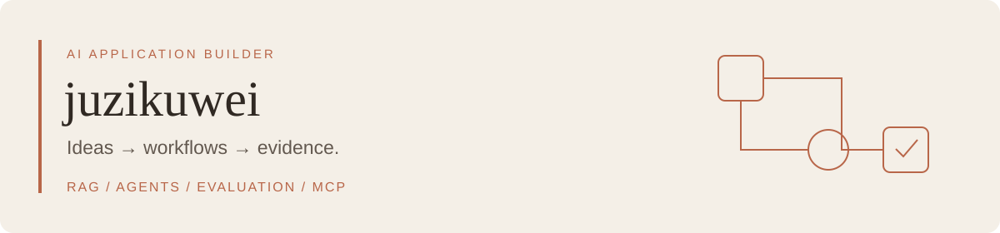
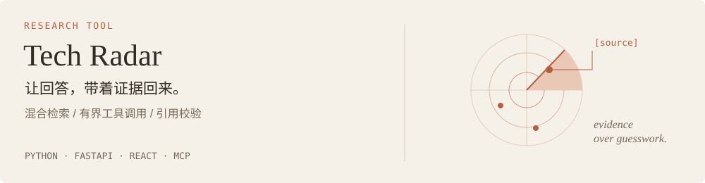
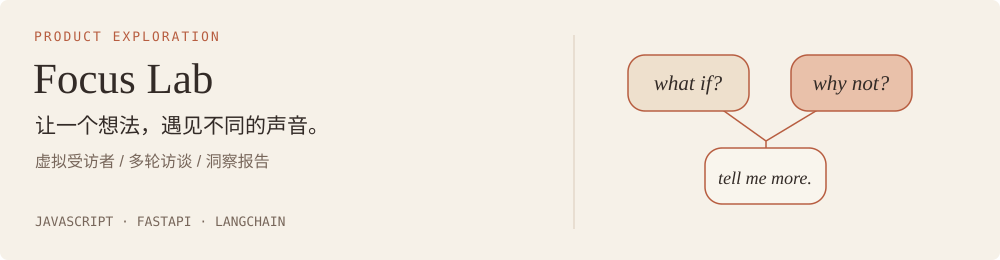
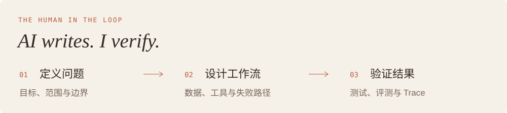
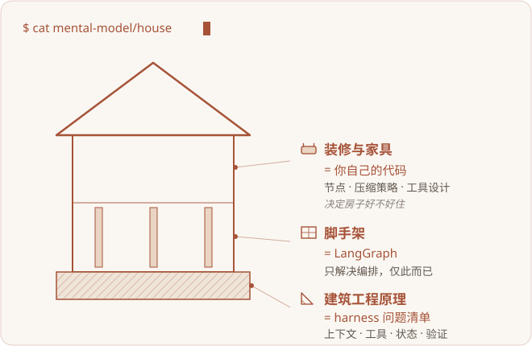
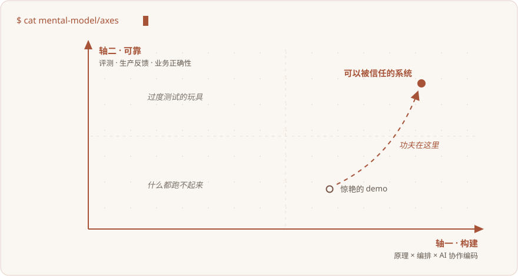

  

  <strong>简体中文</strong> &nbsp; / &nbsp; <a href="README.en.md">English</a>
  &nbsp; · &nbsp; <a href="https://github.com/juzikuwei?tab=repositories">项目仓库</a>
  &nbsp; · &nbsp; <a href="mailto:juzidekuwei@outlook.com">来聊聊 ↗</a>

 

### 工作台上的两个实验

一个探索「答案从哪里来」，一个探索「想法还能怎样看」。

**[AI / Agent Tech Radar ↗](https://github.com/juzikuwei/tech-radar-agent)** &nbsp; 面向 AI 技术资料的研究助手。结合语义检索、BM25 与重排，提供可追溯的引用和只读 MCP 服务。

 

**[Focus Lab · 虚拟焦点小组 ↗](https://github.com/juzikuwei/focus-group-AI-Agent)** &nbsp; 从产品概念生成受访者画像、访谈和报告；支持多模型接口，草稿与结果保存在浏览器本地。

 

### 工具可以生成，判断需要参与

我用 **Claude Code / Codex / Cursor** 编写代码，自己负责产品范围、架构取舍、审查与验收。比起一次漂亮的输出，我更关心下一次失败时，能否找到原因。

> **手边的研究笔记** &nbsp; 会话上下文压缩 · Agent 评测闭环 · 每项结论的证据支持程度

翻开笔记：关于地基、脚手架和可靠性

构建 Agent 系统像盖房子：工程原理是地基，框架是脚手架，具体的产品行为需要自己设计。

先明确范围，再选择框架；先检查证据，再形成结论。把失败路径当作产品行为的一部分，用小实验验证大的设计决定。

看看最近留下的足迹

<picture>
  <source media="(prefers-color-scheme: dark)" srcset="https://raw.githubusercontent.com/juzikuwei/juzikuwei/output/github-contribution-grid-snake-dark.svg" />
  
</picture>

 

---

  <em>Stay curious. Build something real.</em>  
  <a href="mailto:juzidekuwei@outlook.com">juzidekuwei@outlook.com</a> &nbsp; · &nbsp; 中文 / English &nbsp; · &nbsp; UTC+8

